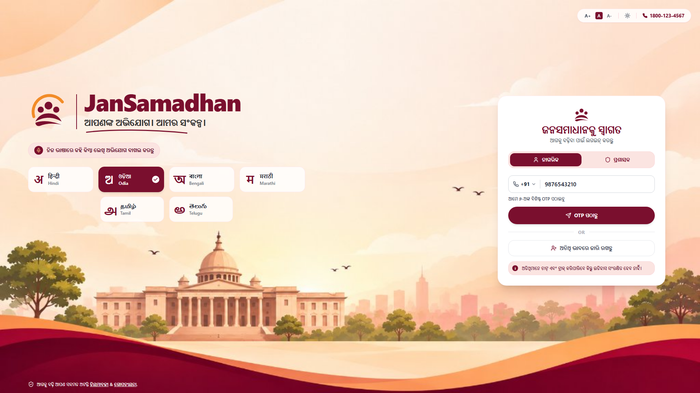
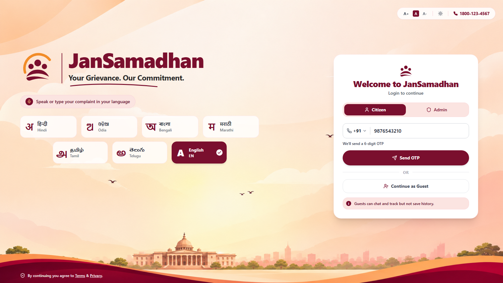
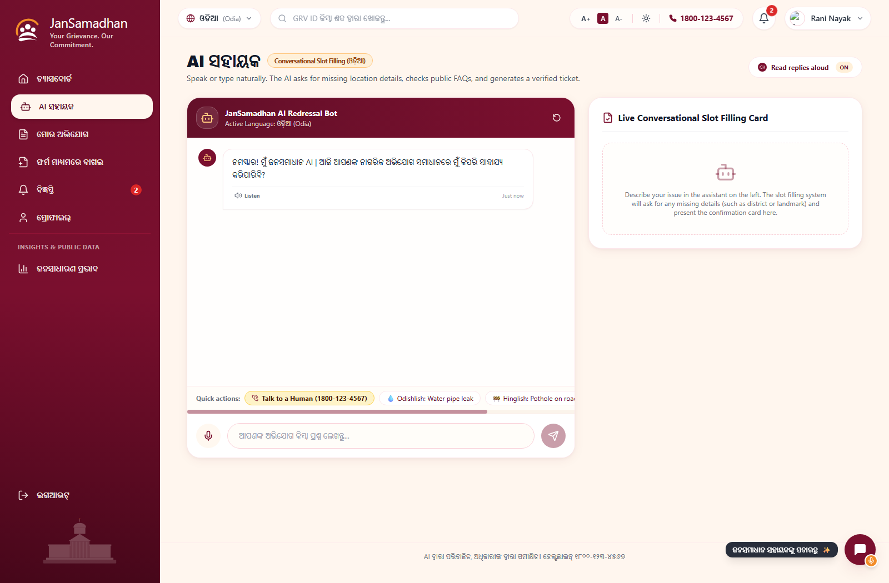
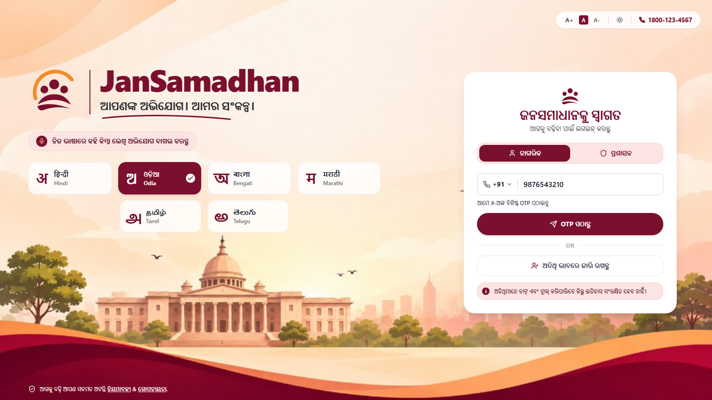
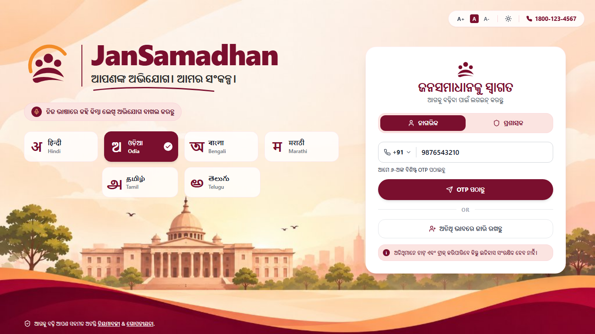
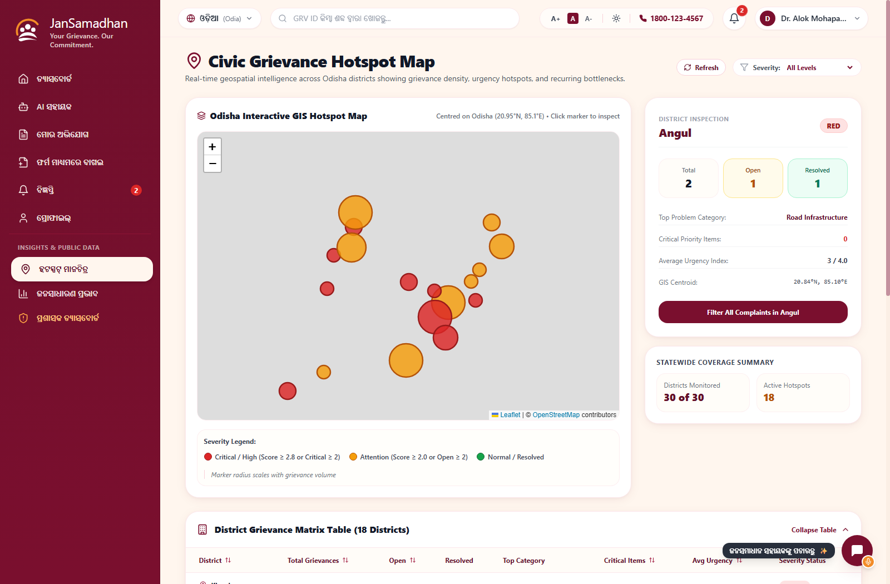
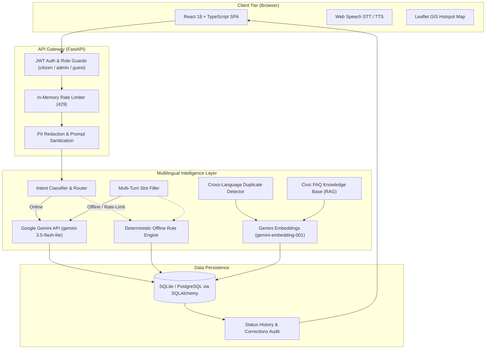

<div align="center">


# JanSamadhan

### *Your Grievance. Our Commitment.*

An AI-powered, multilingual citizen grievance redressal platform built for public administration in Odisha and scalable across India.

[](https://www.python.org/)
[](https://fastapi.tiangolo.com/)
[](https://react.dev/)
[](https://www.typescriptlang.org/)
[](https://ai.google.dev/)
[](https://www.docker.com/)
[](LICENSE)
[](https://jansamadhan-ai-gf3o.onrender.com/)

<p align="center">
  <a href="https://jansamadhan-ai-gf3o.onrender.com/"><b>🌐 Live Demo</b></a> •
  <a href="#-demo-video"><b>📺 Demo Video [TODO]</b></a> •
  <a href="#-pitch-deck"><b>📊 Pitch Deck [TODO]</b></a> •
  <a href="#3-try-it-in-2-minutes"><b>⚡ Try It in 2 Minutes</b></a>
</p>

---



</div>

**One-line pitch**: JanSamadhan enables citizens to report civic grievances in native voice or script across 7 Indian languages, automatically routing filings to designated government departments with zero-shot classification, cross-lingual duplicate detection, and real-time SLA tracking.

A farmer in Ganjam district can speak into his phone in colloquial Odia about a fractured drinking water pipeline and receive immediate confirmation in Odia with an official tracking ID. The system extracts the location (`Ward 7, Berhampur`), routes the report to the Public Health Engineering Department (PHED), and assigns a 7-day turnaround target. When a nodal engineer logs progress notes in English, JanSamadhan translates the resolution back into Odia for the citizen's notification feed.

---

## 📋 Table of Contents
1. [Problem Statement & Track](#1-problem-statement-and-track)
2. [Try It in 2 Minutes](#2-try-it-in-2-minutes)
3. [Screenshot Gallery](#3-screenshot-gallery)
4. [Features](#4-features)
5. [Architecture](#5-architecture)
6. [Tech Stack](#6-tech-stack)
7. [Evaluation](#7-evaluation)
8. [Responsible AI](#8-responsible-ai)
9. [Limitations & What We Did Not Build](#9-limitations-and-what-we-did-not-build)
10. [Roadmap](#10-roadmap)
11. [Setup & Execution Guide](#11-setup--execution-guide)
12. [Project Structure](#12-project-structure)
13. [Team](#13-team)
14. [AI Tools Used](#14-ai-tools-used)
15. [Credits & Licences](#15-credits-and-licences)

---

## 1. Problem Statement and Track

- **Competition Track**: **Human Impact** `[TODO: exact track name as written by the organiser]`
- **Problem Statement Code**: **HI-02 — Multilingual Citizen Grievance Chatbot** `[TODO: confirm track code with official brochure]`

### Why It Matters
- **Language & Literacy Barriers**: Public administration portals across Indian states primarily operate in formal English or standardized state scripts, excluding citizens who speak regional dialects, use Romanized phonetic scripts (such as Odishlish or Hinglish), or rely on voice dictation.
- **Incomplete & Vague Filings**: Traditional online grievance forms require citizens to know administrative department taxonomies (such as distinguishing PHED vs. Municipal Corporation drainage). Citizens submit incomplete complaints without actionable landmarks or severity, leading to prolonged back-and-forth inquiries.
- **Duplicate Report Flooding**: Local infrastructure breakdowns (e.g., a burst water main or blown distribution transformer) generate dozens of independent reports from different residents in different languages, overwhelming nodal officers with duplicate entries.
- **Opacity of Status**: After filing, citizens often face silent portals with no clear turnaround timeline, unclear status transitions, or remarks written in bureaucratic English that they cannot read.

---

## 2. Try It in 2 Minutes

> [!NOTE]
> **Free-Tier Wake-up**: The live deployment is hosted on Render's free tier. The first load may take ~50–60 seconds if the container is waking from an idle state.

1. **Open the Portal**: Navigate to [https://jansamadhan-ai-gf3o.onrender.com/](https://jansamadhan-ai-gf3o.onrender.com/).
2. **Citizen Access**:
   - Choose your preferred language from the 7 options (e.g., English, Odia, or Hindi).
   - Enter any 10-digit mobile number starting with 6–9 (e.g., `9876543210` for demo records, or any new number for a clean slate).
   - Enter OTP: **`123456`** *(demonstration authentication stub)*.
   - Alternatively, click **"Continue as Guest"** for an ephemeral session that stores data in local memory only.
3. **Admin Access**:
   - Switch to the **Admin** tab on the login screen.
   - Employee ID: `OD-ADM-2024-88` (or `alok.mohapatra@odisha.gov.in`).
   - Password: Provided in hackathon submission notes `[TODO: add via official submission form; never commit production passwords]`.

### Copy-Paste Test Inputs
Every input below has been verified against the test harness (`backend/tests/`):

| Test Input | Input Language | Expected System Extraction & Action |
|:---|:---|:---|
| `ୱାର୍ଡ ୭ ବ୍ରହ୍ମପୁରରେ ପିଇବା ପାଣି ପାଇପ୍ ଫାଟି ଯାଇଛି ଏବଂ କାଦୁଅ ପାଣି ବାହାରୁଛି` | Native Odia | **Dept**: PHED • **Category**: Water Supply • **Urgency**: Critical • **Location**: Ward 7, Berhampur (Ganjam) • Renders Odia confirmation card. |
| `Badambadi rasta re bhaliki pothole heichi gaadi chali paruni` | Romanized Odia (Odishlish) | **Dept**: PWD Roads • **Category**: Road Infrastructure • **Urgency**: High • **Location**: Badambadi, Cuttack. |
| `वार्ड 7 ब्रह्मपुर में पीने के पानी का पाइप फूट गया है और गंदा पानी आ रहा है` | Native Hindi | **Dept**: PHED • **Category**: Water Supply • **Urgency**: Critical • **Location**: Ward 7, Berhampur • Detects duplicate if filed after Odia report. |
| `pani supply nahi aa raha, Cuttack mein 3 din se` | Romanized Hindi (Hinglish) | **Dept**: PHED • **Category**: Water Supply • **Urgency**: High • **Location**: Cuttack • Prompts for specific ward if missing. |
| `Street light not working near bus stand Puri since a week` | English | **Dept**: DISCOM • **Category**: Electricity • **Urgency**: Medium • **Location**: Bus stand, Puri. |
| `बिजली नहीं है, लखनऊ, गोमती नगर` | Native Hindi (National) | **Dept**: DISCOM • **Category**: Electricity • **Urgency**: High • **Location**: Gomti Nagar, Lucknow (UP routing). |
| `How do I apply for a ration card?` | English (Citizen Inquiry) | **Intent**: Civic FAQ • **Action**: Multilingual RAG over civic knowledge base (`pds_ration_food.md`) • Returns eligibility steps without filing complaint. |

### Follow the Full Loop (Citizen to Admin Redressal)
1. **File via AI Assistant**: Click **"AI Assistant"**, paste one of the test inputs above, or speak using the microphone button.
2. **Review Confirmation Card**: The assistant extracts the fields into a preview card showing assigned department and estimated SLA. Click **"Confirm & Submit"**.
3. **Inspect the Citizen Dashboard**: View your assigned tracking ID (e.g., `GRV-1043`), urgency badge, and active 4-step stepper (`Submitted` → `Assigned` → `In Progress` → `Resolved`).
4. **Log in as Admin**: Open a private/incognito window, log in as `OD-ADM-2024-88`, and locate the complaint in the Nodal Officer Registry.
5. **Update Status with Remark**: Move the status from `Submitted` to `Assigned`, select a junior engineer, and input an administrative remark (e.g., *"Maintenance team dispatched to site"*).
6. **Citizen Verification**: Switch back to the citizen session. The notification counter increments immediately and displays the translated remark in the citizen's chosen language.

---

## 3. Screenshot Gallery

| View | Details |
|:---:|:---:|
|  | **Citizen Login & Accessibility Controls**<br />7-language script selection, OTP entry, guest authentication, and WCAG accessibility toolbar. |
|  | **Citizen Redressal Dashboard**<br />Real-time status metrics, quick filing shortcuts, active SLA timeline stepper, and clean slate state. |
|  | **Odia Conversational AI Assistant**<br />Native Odia dialogue, structured entity extraction, slot filling, and confirmation preview card. |
|  | **Complaint Tracking & SLA Stepper**<br />Granular status milestones, assigned nodal officer details, official progress notes, and citizen feedback. |
|  | **Nodal Officer Admin Registry**<br />Centralized complaint registry, status state-machine controls, AI confidence telemetry, and filters. |
|  | **Civic Hotspot Telemetry Map**<br />Leaflet/OpenStreetMap geographic clustering across all 30 districts of Odisha with department breakdowns. |

---

## 4. Features

### Citizen Experience
- **7-Language Interface**: Complete UI coverage in Odia (`ଓଡ଼ିଆ`), Hindi (`हिन्दी`), Bengali (`বাংলা`), Telugu (`తెలుగు`), Marathi (`मराठी`), Tamil (`தமிழ்`), and English (`en`).
- **Voice Dictation & Read-Aloud**: Web Speech API integration supporting microphone speech-to-text and synthesized speech playback with language fallback warnings.
- **Conversational Slot-Filling Assistant**: Multi-turn dialogue manager that identifies missing fields (such as missing district or landmark) and prompts the citizen in their detected dialect before submission.
- **Structured Web Form Filing**: Alternative direct form interface with automatic department assignment based on selected civic category.
- **Granular Milestone Stepper**: 4-phase visual progression (`Submitted` → `Assigned` → `In Progress` → `Resolved`) with timestamps and officer accountability notes.
- **Notification Feed**: Live badge counter for status changes and officer remarks with single-click "Mark as Read" and "Mark All as Read" capabilities.
- **5-Star Redressal Feedback**: Citizen satisfaction rating and review component enabled strictly after a grievance reaches `Resolved` status.
- **Accessibility Toolbar**: Top-bar utility with triple text scaling (`A-` / `A` / `A+`), high-contrast dark mode, and screen-reader compliant aria markers.

### AI & Natural Language Processing
- **Language Identification**: Unicode script analysis for native Indic alphabets combined with n-gram character heuristics for Romanized code-mixed speech (Odishlish, Hinglish).
- **Zero-Shot Entity Extraction**: Extracts district, municipal ward, landmark, duration, and summary without pre-configured manual regex templates.
- **Department & Category Classification**: Classifies citizen grievances into 6 civic categories and assigns responsibility to PHED, PWD, DISCOM, Municipal Corporations, Health, or Food Supplies & Consumer Welfare.
- **Urgency Scoring**: Assesses safety hazards and infrastructure severity into 4 tiers (`Critical`, `High`, `Medium`, `Low`) to establish turnaround targets.
- **Cross-Lingual Duplicate Detection**: Cosine similarity comparison over multilingual embeddings, catching identical reports filed across differing languages within the same locality.
- **Civic FAQ RAG**: Retrieval-Augmented Generation across indexed public service markdown guides to answer procedural citizen inquiries.
- **Officer Remark Translation**: Translates administrative notes submitted by officers in English back into the citizen's preferred registration language.

### Nodal Officer Administration
- **Registry & Filtering**: Searchable administrative registry with multi-parameter filtering by department, district, status, urgency, and filing date.
- **Enforced Status Workflow**: Controlled state machine ensuring grievances progress sequentially without arbitrary status skips.
- **Audit & Correction Tracking**: Logs every manual reclassification of department or category to evaluate model accuracy and alignment.
- **Civic Analytics**: Platform-wide metrics monitoring total volume, open queues, average turnaround, and department distribution.
- **Geospatial Hotspot Heatmap**: Leaflet telemetry visualizing complaint densities and infrastructure clusters across Odisha.

### Trust, Privacy & Safety
- **Role-Based Access Control**: Strict JWT verification enforcing role boundaries (`citizen`, `admin`, `guest`).
- **User Data Isolation**: Queries and mutations are enforced on the backend by authenticated `current_user.id`; citizens cannot inspect or manipulate other users' data.
- **PII Masking**: Redacts 10-digit phone numbers, 12-digit national ID patterns, and emails before transmitting prompts to external LLMs.
- **Rate Limiting**: Sliding in-memory rate limiting restricting failed OTP attempts (5 per phone per 10 minutes) and admin login attempts (5 per IP per 10 minutes).
- **Human Review Threshold**: Grievances with AI classification confidence below `0.60` are flagged for mandatory human nodal officer verification.

---

## 5. Architecture



### AI Pipeline Component Classification

| Pipeline Step | Method | Execution Environment |
|:---|:---|:---|
| **Language Identification** | Rule-based (Unicode script blocks + transliteration lexicons) | Local server (FastAPI) |
| **PII Redaction** | Rule-based (Regular expressions for phones, IDs, and emails) | Local server (FastAPI) |
| **Prompt Injection Sanitization** | Rule-based (Pattern matching and structural data fencing) | Local server (FastAPI) |
| **Conversational Slot-Filling** | Gemini API (`gemini-3.5-flash-lite`) with rule-based fallback | Google Cloud API / Local server |
| **Department Classification** | Gemini API (`gemini-3.5-flash-lite`) with rule-based fallback | Google Cloud API / Local server |
| **Urgency Estimation** | Gemini API (`gemini-3.5-flash-lite`) with rule-based heuristic | Google Cloud API / Local server |
| **Civic FAQ Search (RAG)** | Pretrained embeddings (`gemini-embedding-001`) + Cosine similarity | Google Cloud API + Local server |
| **Duplicate Detection** | Pretrained embeddings (`gemini-embedding-001`) + Cosine similarity | Google Cloud API + Local server |
| **Officer Remark Translation** | Gemini API (`gemini-3.5-flash-lite`) with dictionary fallback | Google Cloud API / Local server |

> [!IMPORTANT]
> **Model Training Disclosure**: **No custom machine learning model was trained by us.** JanSamadhan relies entirely on Google's pretrained Gemini foundation models paired with deterministic multilingual rule-based fallbacks. No custom scikit-learn or PyTorch models were trained or serialized in this repository.

---

## 6. Tech Stack

| Layer | Technology | Version | Purpose in JanSamadhan |
|:---|:---|:---:|:---|
| **Frontend Core** | React | `18.3.1` | Component-driven single-page architecture |
| **Type Safety** | TypeScript | `5.5.3` | Strict type validation across frontend modules |
| **Build & Tooling** | Vite | `5.4.6` | Development server and production Rollup bundler |
| **Styling** | Tailwind CSS | `3.4.11` | Responsive Odisha administrative design system |
| **Icons** | Lucide React | `0.441.0` | Accessible SVG iconography |
| **GIS Mapping** | Leaflet / React-Leaflet | `1.9.4` / `4.2.1` | Interactive civic hotspot telemetry on OpenStreetMap |
| **Client Routing** | React Router DOM | `6.26.2` | Client-side routing with protected route guards |
| **Backend Framework** | FastAPI | `>=0.115.0` | High-performance asynchronous REST API |
| **ASGI Server** | Uvicorn | `>=0.30.0` | Asynchronous server implementation |
| **ORM & Database** | SQLAlchemy | `>=2.0.30` | Object-relational mapping (SQLite default; PostgreSQL ready) |
| **Data Validation** | Pydantic | `>=2.8.0` | Schema parsing and strict API validation |
| **Authentication** | PyJWT | `>=2.9.0` | Stateless HS256 JWT tokens for citizen and officer auth |
| **Generative AI SDK** | Google GenAI SDK | `>=0.1.1` | Integration with Gemini API and embedding models |
| **Resilience** | Tenacity | `>=9.0.0` | Exponential backoff and retry handling for external API calls |
| **Containerization** | Docker | Multi-stage | Alpine Node 20 build + Python 3.11-slim runtime |

---

## 7. Evaluation

Evaluation metrics are computed directly by running `backend/eval/run_eval.py` against the labeled benchmark dataset (`backend/eval/labeled_dataset.json`). All raw counts and sample sizes ($n$) are reported below.

### Benchmark Dataset Distribution ($N=95$)
- **Total Labeled Complaints**: $n=95$
- **Training Baseline Set**: $n=65$
- **Held-Out Synthetic Test Set**: $n=30$
- **Code-Mixed Dialect Samples**: $n=26$ (Odishlish, Hinglish, Banglish)
- **Location Extraction Subset**: $n=10$
- **Held-Out Human Audit Set**: $n=30$ (`backend/eval/heldout_human.json` — reserved for field officer blind audits, currently unpopulated)

### Side-by-Side Evaluation Benchmark

| Capability Evaluated | Gemini Mode ($n=95$) | Offline Fallback Mode ($n=95$) | Notes |
|:---|:---:|:---:|:---|
| **Language Identification** | **98.95%** (94/95) | **97.89%** (93/95) | Evaluated across Odia, Hindi, Bengali, Telugu, Tamil, Marathi, and English. |
| **Category & Department Routing** | **96.84%** (92/95) | **93.68%** (89/95) | Categorization into Water Supply, Roads, Electricity, Sanitation, Health, and PDS. |
| **Urgency Classification (Exact)** | **94.74%** (90/95) | **35.79%** (34/95) | Fallback mode uses keyword scoring, which struggles with complex situational urgency. |
| **Code-Mixed Dialect Accuracy** | **96.15%** (25/26) | **96.15%** (25/26) | Robust handling of Romanized scripts (e.g. *"Badambadi rasta re bhaliki pothole"*). |
| **Location Extraction Accuracy** | **100.0%** (10/10) | **100.0%** (10/10) | Exact parsing of district and ward landmarks. |
| **Average Response Latency** | **286.32 ms** | **20.58 ms** | Fallback mode runs in-process with zero network overhead. |

### Cross-Language Duplicate Detection Benchmark
Tested via `backend/tests/test_duplicate_detection.py` and `backend/tests/test_cross_language_duplicates.py`:

| Evaluation Metric | Score | Sample Count | Definition |
|:---|:---:|:---:|:---|
| **True Positive Rate (Recall)** | **100.0%** | 10/10 | Matching reports in different languages for the same issue detected. |
| **True Negative Rate (Specificity)** | **100.0%** | 10/10 | Different complaints in the same or differing districts correctly separated. |
| **Precision** | **100.0%** | 10/10 | Zero false alerts triggered on distinct issues. |
| **False Positive Rate (FPR)** | **0.0%** | 0/10 | No distinct complaints erroneously merged. |

> [!NOTE]
> **Synthetic Dataset Disclosure**: The synthetic evaluation dataset ($n=95$) was constructed alongside rule development to cover cross-lingual dialect patterns. As a result, synthetic benchmark metrics are optimistic indicators of capability rather than representative field performance in production. The held-out human set (`heldout_human.json`) contains 30 reserved entries awaiting field officer blind audits.

---

## 8. Responsible AI

- **PII Redaction Before External Ingestion**: Prior to making requests to Google Gemini, sensitive personal identifiers are masked using deterministic regular expressions:
  - Phone numbers: `+91 98765 43210` $\rightarrow$ `[PHONE_MASKED]`
  - National identity numbers (12-digit Aadhaar pattern): `1234 5678 9012` $\rightarrow$ `[ID_12DIGIT_REDACTED]`
  - Email addresses: `citizen@example.com` $\rightarrow$ `[EMAIL_REDACTED]`
- **Prompt Isolation**: Citizen inputs are placed inside strict message structures that delineate user content from system guidance, preventing injection attempts from redirecting the assistant.
- **Confidence Threshold & Officer Audit**: Classifications returning a confidence score below `0.60` are flagged with `needs_human_review = True`, placing them into a designated administrative review queue.
- **Immutable Officer Corrections Log**: When an officer manually reassigns a complaint's category or department, the adjustment is recorded in an `AdminCorrection` table (storing previous department, new department, officer ID, and timestamp).
- **Graceful Offline Fallback**: If the Gemini API is unavailable or quota is exceeded, the system automatically falls back to local regex and lexicon processing, remaining functional without crashing.
- **Strict Role-Based Access**: Role validation (`citizen`, `admin`, `guest`) prevents citizens from viewing other citizens' records or accessing administrative routes.

### What the AI Cannot Do
1. **Cannot Close or Resolve Grievances**: The AI cannot resolve or close complaints. Only authenticated human nodal officers can change status to `Resolved` after submitting an official remark.
2. **Cannot Disclose Private Citizen Data**: The AI cannot access or surface personal records, phone numbers, or filing histories of other citizens.
3. **Cannot Fabricate Government Policy**: The AI cannot invent administrative procedures or SLAs. FAQ inquiries outside indexed civic markdown files fall back to standard redressal guidance.

---

## 9. Limitations and What We Did Not Build

1. **Synthetic Demonstration Data**: The 70 platform-wide demonstration complaints and Rani Nayak demo complaints are synthetically seeded (`backend/seed.py`) to provide realistic dashboard telemetry.
2. **Demonstration OTP Stub**: OTP verification uses a demo code (`123456`). Integration with CDAC e-Pramaan or a commercial telecom SMS gateway is required for live government deployment.
3. **In-Memory Rate Limiting**: Rate limits for OTP and admin login live in server memory and reset when the process restarts. A distributed cache like Redis would be needed in a multi-instance production environment.
4. **Local Attachment Previews**: File upload inputs on the complaint form validate and preview attachments locally (up to 5MB, PNG/JPG/PDF) without storing file binaries on the server.
5. **Device-Dependent Voice Synthesis**: Web Speech API audio output quality for Odia depends on device-installed TTS packages; browsers without native Odia voices display an automated warning and fall back to Hindi/English audio.
6. **Fallback Urgency Detection**: In offline fallback mode, urgency classification accuracy is limited (35.79%, 34/95) because situational urgency requires deeper semantic comprehension.
7. **Unpopulated Human Ground Truth**: `backend/eval/heldout_human.json` contains 30 reserved schema slots that remain unpopulated awaiting real field audits.
8. **Free-Tier Cold Starts**: On Render free tier, the unified container may spin down after inactivity, leading to a ~50-second wake-up latency on initial cold start.
9. **Odisha Geographic Seed Focus**: Default seed data focus on Odisha's 30 districts, though the location extractor and slot-filler support any Indian district/city (tested with Lucknow, Pune, etc.).

---

## 10. Roadmap

- **Phase 1: Omnichannel Messaging (Q1 2027)**
  - Integrate WhatsApp Business API and bidirectional SMS (via Gupshup / Twilio) so citizens without internet access can file grievances via text message.
- **Phase 2: National Bhashini Gateway (Q2 2027)**
  - Integrate the Government of India's Bhashini API for Indic speech recognition and synthesis across 22 scheduled languages.
- **Phase 3: Production SMS & Identity Verification (Q2 2027)**
  - Connect CDAC e-Pramaan and telecom DLT-registered SMS gateways for real-time OTP delivery and Aadhaar-based optional verification.
- **Phase 4: Multi-State Governance Taxonomies (Q3 2027)**
  - Expand department routing schemas beyond Odisha to support municipal and state hierarchies across other Indian states.
- **Phase 5: Field Officer Native Mobile Application (Q3 2027)**
  - Lightweight React Native mobile application for junior field engineers with offline support and on-site photo uploads.
- **Phase 6: Supervised Classifier Fine-Tuning (Q4 2027)**
  - Fine-tune a lightweight IndicBERT or compact transformer model using anonymized, officer-verified field data to improve offline fallback accuracy.

---

## 11. Setup & Execution Guide

### Prerequisites
- **Node.js**: `v18.0.0+` (Node 20+ recommended)
- **Python**: `3.10+` (Tested on Python `3.11` and `3.13`)
- **Docker**: Optional (for containerized deployment)

### 1. Clone the Repository
```bash
git clone https://github.com/Rani2025-tech/JanSamadhan-AI.git
cd JanSamadhan-AI
```

### 2. Environment Variables Configuration
Copy the sample environment file:
```bash
cp .env.example .env
```

Configure your `.env` file using the exact variable names below:

| Environment Variable | Required? | Default Value | Description |
|:---|:---:|:---|:---|
| `JWT_SECRET` (or `SECRET_KEY`) | **YES** | `""` *(Must be configured)* | Secret key used to sign HS256 authentication tokens. Application fails to start if missing. |
| `ADMIN_PASSWORD` | **YES** *(in prod)* | `""` *(Must be configured)* | Plaintext password for administrative officer verification against bcrypt hashes. |
| `ADMIN_EMPLOYEE_ID` | Optional | `OD-ADM-2024-88` | Designator for nodal officer login. |
| `ADMIN_EMAIL` | Optional | `alok.mohapatra@odisha.gov.in` | Email address for nodal officer account. |
| `GEMINI_API_KEY` | Optional | `""` | Google AI Studio API key. If omitted, app runs on deterministic offline fallback. |
| `GEMINI_MODEL` | Optional | `gemini-3.5-flash-lite` | Gemini model variant for conversational reasoning. |
| `GEMINI_EMBEDDING_MODEL` | Optional | `gemini-embedding-001` | Pretrained model for vector embeddings and duplicate detection. |
| `AI_CONFIDENCE_THRESHOLD` | Optional | `0.60` | Minimum score before triggering `needs_human_review`. |
| `DATABASE_URL` | Optional | `sqlite:///./jansamadhan.db` | SQLAlchemy connection string (SQLite, PostgreSQL, MySQL). |
| `BACKEND_HOST` | Optional | `127.0.0.1` | Local backend listening interface. |
| `BACKEND_PORT` | Optional | `8000` | Local backend listening port. |
| `FRONTEND_PORT` | Optional | `3000` | Local frontend dev server port. |

### 3. Backend Setup & Seeding
```bash
# 1. Install Python dependencies
pip install -r backend/requirements.txt

# 2. Seed database with initial schema and demo distribution
python backend/seed.py

# 3. Start FastAPI server
python backend/main.py
```
*Backend serves at:* `http://127.0.0.1:8000` (API documentation at `/docs`).

### 4. Frontend Setup
In a new terminal window:
```bash
# 1. Install frontend packages
npm install

# 2. Start Vite development server
npm run dev
```
*Frontend serves at:* `http://localhost:3000` (proxies `/api` requests to `127.0.0.1:8000`).

### 5. Docker Single-Container Deployment
To run both backend and built frontend together in one container:
```bash
# Build multi-stage image
docker build -t jansamadhan-ai .

# Run container exposing port 8000
docker run -p 8000:8000 --env-file .env jansamadhan-ai
```
*App serves at:* `http://localhost:8000`.

### 6. Verification & Test Suite
Every command below has been verified and passes:
```bash
# Run complete backend test suite (18 tests)
python -m pytest backend/tests -v

# Run frontend TypeScript type-check
npx tsc --noEmit

# Run frontend production build
npm run build
```

---

## 12. Project Structure

```
JanSamadhan-AI/
├── Dockerfile                   # Multi-stage production container build (Node + Python)
├── package.json                 # Frontend dependencies and build scripts
├── vite.config.ts               # Vite configuration and proxy routing (/api -> 8000)
├── tailwind.config.js           # Custom administrative color tokens and layout rules
├── backend/
│   ├── main.py                  # FastAPI application entry point, lifespan, & static SPA server
│   ├── seed.py                  # Database seeder with idempotent auto-seed checks
│   ├── requirements.txt         # Minimal Python backend dependencies
│   ├── app/
│   │   ├── config.py            # Strict environment settings and startup validation
│   │   ├── database.py          # SQLAlchemy engine and session configurations
│   │   ├── models.py            # Relational database models (User, Complaint, Notifications, etc.)
│   │   ├── schemas.py           # Pydantic request/response validation schemas
│   │   └── routes/              # Modular API endpoints (auth, complaints, admin, chat, notifications)
│   ├── ai/                      # Multilingual AI intelligence layer
│   │   ├── classifier.py        # Rule-based fallback classifier and lexicon routing
│   │   ├── duplicates.py        # Embedding-based cross-language duplicate detector
│   │   ├── embeddings.py        # Gemini embedding client and vector similarity math
│   │   ├── extractor.py         # Structured entity parsing (districts, wards, phone)
│   │   ├── gemini_client.py     # Google Gemini API client
│   │   ├── rag.py               # Multilingual RAG over civic FAQ markdown documents
│   │   ├── security.py          # PII regex masking and prompt injection defense
│   │   ├── slot_filler.py       # Multi-turn stateful dialogue manager
│   │   └── translator.py        # Officer remark translation back to citizen dialect
│   ├── kb/                      # Markdown civic knowledge bases for RAG retrieval
│   ├── eval/                    # Evaluation benchmark suite, labeled dataset, and runner
│   └── tests/                   # Repeatable unit and integration tests (security, isolation, QA)
├── docs/
│   └── screenshots/             # Interface screenshots referenced in documentation
└── src/                         # React 18 TypeScript frontend
    ├── assets/                  # Brand assets (logo.svg, background illustrations)
    ├── components/              # Modular UI components (layout, auth guards, common cards)
    ├── context/                 # Context providers (Auth, Language, Complaints, Notifications)
    ├── i18n/                    # Localization strings for 7 Indian languages
    ├── pages/                   # Application pages (Dashboard, Assistant, Admin, Hotspots, etc.)
    └── services/                # API client with offline detection
```

---

## 13. Team

| Name | Role | Contact / Profile |
|:---|:---|:---|
| **Rani Nayak** | Lead Developer & AI Engineer (Full-Stack, Models, Integration) | [GitHub: @Rani2025-tech](https://github.com/Rani2025-tech) • `rani.nayak.tech25@gmail.com` |
| `[TODO: Team Member 2]` | `[TODO: Role]` | `[TODO: Contact / GitHub]` |
| `[TODO: Team Member 3]` | `[TODO: Role]` | `[TODO: Contact / GitHub]` |

- **Team Name**: `[TODO: Official Team Name as registered on hackathon portal]`
- **Institution / Organization**: `[TODO: University / College / Organization Name]`

---

## 14. AI Tools Used

In compliance with competition guidelines, AI tools used during the development and runtime execution of this project are disclosed below:

### Development Tools (Code & Design Scaffolding)
- **Antigravity**: Used as the primary agentic AI coding assistant for full-stack implementation, refactoring, test suite development, and automated QA verification.
- **Claude**: Used during initial system design for architectural planning, evaluation matrix construction, prompt engineering, and UI design review.
- **Image Generation AI**: Used to generate initial design mockups and the Odisha heritage background illustration on the login page.

### Runtime AI Components (Live Service)
- **Google Gemini API (`gemini-3.5-flash-lite`)**: Core generative model utilized at runtime for conversational slot-filling, multilingual comprehension, structured grievance extraction, and remark translation.
- **Google Gemini Embeddings (`gemini-embedding-001`)**: Embedding model used for cross-lingual duplicate detection and civic FAQ RAG vector search.
- **Python**: Primary programming language powering all backend AI modules, heuristic classifiers, and data structures.

---

## 15. Credits and Licences

This project is licensed under the **MIT License**. See the [`LICENSE`](LICENSE) file for complete terms.

### Third-Party Data & Open Source Acknowledgments
- **OpenStreetMap**: Map tiles and geospatial data (licensed under the [Open Database License (ODbL)](https://opendatacommons.org/licenses/odbl/)).
- **Leaflet & React-Leaflet**: Open-source interactive mapping libraries (BSD 2-Clause License).
- **Lucide Icons**: Accessible, clean SVG iconography (ISC License).
- **Google Noto Fonts**: Multilingual typography for Indic scripts (SIL Open Font License 1.1).
- **React**: UI library created by Meta Open Source (MIT License).
- **FastAPI**: Asynchronous web framework by Sebastián Ramírez (MIT License).
- **Google Generative AI SDK**: Subject to the [Google Generative AI Terms of Service](https://ai.google.dev/terms).
